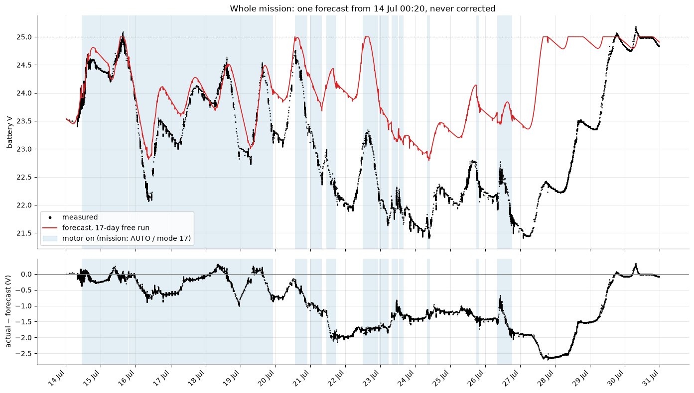
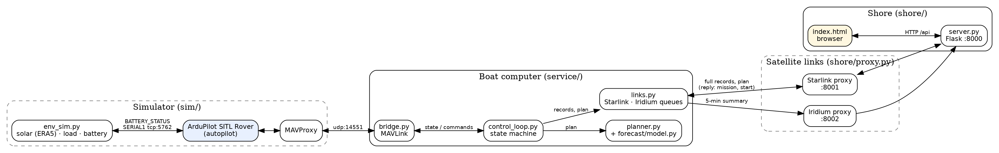

# Scout — Write-up

## Where the energy goes
Load = battery1 V × battery2 A (total draw). Split per minute:

| consumer | power | how (nb) |
| --- | --- | --- |
| Hotel | 10 W (5–15 W over a day) | MANUAL, Starlink off: load doesn't change with speed (06) |
| Starlink | 22 W when on | MANUAL only, Starlink on − off: 21 W disarmed, 23 W armed (06) |
| Motor | 62.7·v² W (AUTO), 60.6·v² W (mode 17) | see below (08) |

**Motor:** motor power = load − 10 W hotel − 22 W · Starlink, plotted against the speed the boat was asked for. That speed comes from the mission we reverse-engineered (nb 04): one line per mode change, at the line's median speed over ground. Motor-on minutes only, one k per mode, no intercept. No ocean-current model for now: speed over ground is taken as the speed through water.

Model split over the 17 days: 12.6 kWh out, propulsion 7.4 (59 %), hotel 4.1 (33 %), Starlink 1.1 (9 %); solar in 15.1 kWh (12).

At 1 m/s in AUTO: motor 63 W, total 73 W (95 W with Starlink). Solar in: up to 52–172 W peak per day (10).

## What surprised me in the data
- **Holding looks like moving.** Mode-17 holds show 0.3 m/s over ground but the motor draws 2–5 W: it's current drift (09). Biggest single forecast error (+1.5 V on 17 Jul). Open: motor = 0 below ~0.4 m/s.
- **η = 1.14 in the battery fit.** Solar in > 1 is not physical; we treat it as a sensor scale factor (11).
- **Solar is only measured over Starlink**, which runs in ~10 min sessions and stops on 27 Jul. Solar is modelled as one daily curve shape (10).
- battery1 and battery2 voltage are the same measurement; Globalstar `battery_pct` is always 0 (01).

## How good the forecast is
_Todo: still fitted on the same 17 days it forecasts; no held-out test yet._
- 24 h pieces: mean |end error| 0.36 V. Free run 17 days: RMSE 0.95 V (12).
- Battery model alone (measured inputs): RMSE 0.40 V, 0.16 V on 24 h pieces.

- Solar energy is right (11.55 vs 11.54 kWh); load is ~1.1 kWh low to 27 Jul. Error is in *when*, not *how much*.
- Trust: next 24 h from a fresh voltage reading. Don't trust: multi-day free runs, long low-speed holds.

## What the mode decides
- **Autopilot mode:** switches AUTO / HOLD automatically.
- **Waypoints:** uploads the mission's waypoints to the autopilot.
- **Speed:** sets the speed to follow, one per hour, from the plan.

## Where each part runs

_Todo: text._

## What we chose not to build
_Todo._
